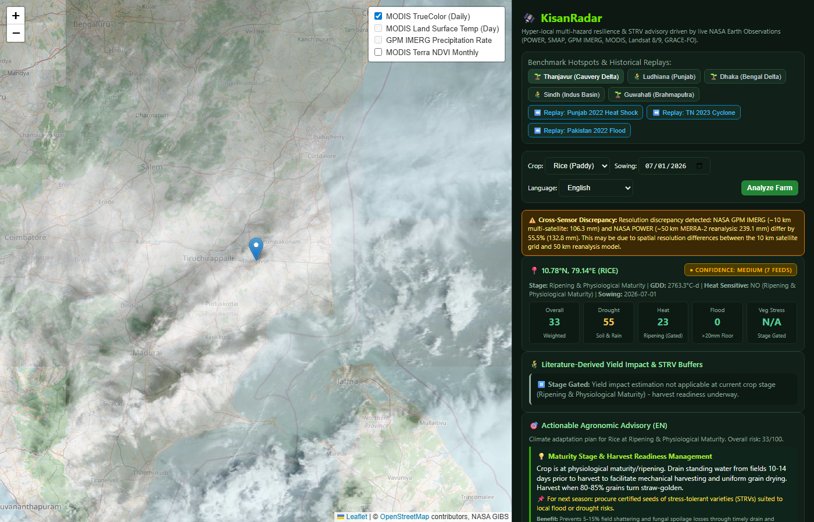

# 🛰️ KisanRadar: Hyper-Local Agricultural Climate Resilience Platform

> **NASA International Space Apps Challenge 2026**  
> **Challenge:** *Field Shift: Adapting Farms with NASA Data*  
> **Repository:** [GitHub](https://github.com/visshaalpvt/NASASPACEAPPS)  
> **License:** MIT License  



---

## 🌾 Overview

Across South Asia, 86% of India's farmers cultivate holdings under 2 hectares, bearing the brunt of accelerating climate hazards: scorching terminal heatwaves that abort grain filling, flash droughts that desiccate rainfed crops, and monsoon cloudbursts that submerge delta paddy fields. 

While NASA operates world-class Earth observation satellites, this telemetry remains locked in scientific repositories (HDF5, NetCDF, GEE image collections) inaccessible to a farmer with a 1-hectare holding.

**KisanRadar** bridges this last-mile gap:
1. **Hyper-Local Risk Scoring (0–100):** Real-time diagnoses of **Drought**, **Terminal Heat**, **Flash Flood**, and **Canopy Vegetation Stress**.
2. **Empirical Climatological Baselines:** Every observation is evaluated against the 2001–present historical distribution of that exact calendar window (percentiles, not arbitrary static thresholds).
3. **Phenology & Stage Gating:** Growing Degree Day (GDD) tracking ensures terminal heat thresholds only trigger during critical reproductive/anthesis windows, and canopy NDVI anomalies are suppressed during emergence and ripening.
4. **Actionable Climate-Smart Advisories:** Grounded in research brief benchmarks (Safe AWD, Swarna-Sub1, Sahbhagi Dhan, common practice wheat heat defense and Happy Seeder mulching), translated across 6 regional languages.
5. **Historical Replays:** Interactive telemetry replaying verified historical shocks (Punjab March 2022 Heatwave, Pakistan Sindh August 2022 Deluge, Tamil Nadu December 2023 Cyclone Michaung).
6. **Zero Mock Data Policy:** Every single score and chart is computed directly from live telemetry or authentic archived NASA feeds (cached presets 0.3 s; live analysis ~19 s cold).

---

## 🛰️ NASA Earth Observation Feeds & Data Provenance

| Sensor / Mission | Dataset ID | Spatial Resolution | Temporal Frequency | Role in KisanRadar | Freshness / Caveats |
| :--- | :--- | :--- | :--- | :--- | :--- |
| **NASA GPM IMERG** | `NASA/GPM_L3/IMERG_V07` | ~0.1° (~10 km) | 30-min / Daily | Primary 30-day rainfall accumulation & 72h flood risk | Late Run (~2.5-day latency) |
| **NASA SMAP L4** | `NASA/SMAP/SPL4SMGP/008` | 9 km | Daily | Root-zone soil wetness fraction & historical percentile | ~2-day assimilation lag |
| **NASA POWER** | `NASA_POWER_AG_POINT_DAILY_V2` | 0.5° (~50 km) | Daily (2001–pres.) | Long-term climatological baseline (>9,400 daily points), GDD thermal time, MERRA-2 cross-check | ~2 to 4-day lag |
| **MODIS Terra** | `MODIS/061/MOD13Q1` & `MOD11A1` | 250 m / 1 km | 16-day / Daily | 2001+ regional NDVI canopy anomaly & Land Surface Temp (LST) | 16-day composite |
| **Landsat 8 & 9** | `LANDSAT/LC08/C02/T1_L2` | 30 m | 16-day revisit | Parcel-scale field NDVI vs regional MODIS baseline | Clearest scene in last 90 days |
| **NASA GRACE / GRACE-FO** | `NASA/GRACE/MASS_GRIDS_V04/MASCON_CRI` | ~300 km | Monthly | Long-term regional total water storage trend | **Ends 2024-09**; regional gravimetry, NOT parcel groundwater table |
| **NASA GIBS WMTS** | `MODIS_Terra_CorrectedReflectance_TrueColor` | Global WMTS | Near Real-Time | Interactive Leaflet basemap satellite overlays | 24-hour cached capabilities |
| **Open-Meteo NWP** | `OPEN_METEO_SEAMLESS_DAILY_V1` | ~11 km | Hourly / 7-day | 7-day forward weather forecast (Tmax, precipitation) | **Non-NASA NWP model** |

---

## 📊 Replay Case Studies (Archived NASA Telemetry)

1. **Punjab March 2022 Terminal Heat Shock** (`30.90°N, 75.85°E`, Wheat):
   - **Historical Context:** Temperatures reached 40°C by mid-March during grain-filling.
   - **Replay Measured Values:** NASA POWER Tmax 38.3°C, MODIS LST Day 38.0°C.
   - **Heat Risk Score:** 96/100.
   - **Yield Impact:** Scenario estimate capped at 25.0% loss (documented CIMMYT/ICAR benchmark: 10–35%; model at upper cap).

2. **Pakistan Sindh August 2022 Flood Deluge** (`26.00°N, 68.50°E`, Rice):
   - **Historical Context:** In August 2022, about one-third of Pakistan was inundated, with over 8 million acres of crops lost to monsoon deluges.
   - **Replay Measured Values:** NASA GPM IMERG 30d Rain 563.5 mm (100th percentile).
   - **Flood Risk Score:** 100/100.
   - **Advisory:** Swarna-Sub1 submergence resilience (+1.0 to 3.0 t/ha recovery, IRRI trials; not effective under stagnant flooding deeper than 20 cm for over 20 days).

3. **Tamil Nadu December 2023 Cyclone Michaung** (`13.08°N, 80.27°E`, Rice):
   - **Replay Measured Values:** NASA GPM IMERG 30d Rain 656.2 mm (95.8th percentile); NASA POWER cross-check 556.7 mm (90.9th percentile, 15.2% gap — below the 30% flag threshold).
   - **Flood Risk Score:** 100/100.

---

## 🛠️ Quickstart & Local Installation

### Prerequisites
- Python 3.10+ (tested on Python 3.11)
- Google Earth Engine service account or authenticated user account (`earthengine authenticate`)

### Installation Steps
```bash
# Clone the repository
git clone https://github.com/visshaalpvt/NASASPACEAPPS.git
cd NASASPACEAPPS

# Install dependencies
pip install -r requirements.txt

# Configure Earth Engine project (optional: falls back to graceful skip if uncredentialed)
echo "EE_PROJECT=your-gee-project-id" > .env

# Run unit and regression test suite (15 tests)
pytest tests/test_analytics.py -v

# Start KisanRadar server
uvicorn app.main:app --host 127.0.0.1 --port 8000 --reload
```
Open **`http://localhost:8000`** in any web browser.

---

## 🧪 Testing & Verification

KisanRadar includes automated test suites covering science logic and end-to-end browser workflows:
```bash
# 1. Run full analytics unit tests (percentiles, GDD, stage-gating, yield caps)
pytest tests/test_analytics.py -v

# 2. Run multi-hazard verification across diverse South Asian sites
python scripts/test_diverse_sites.py

# 3. Run Playwright headless browser test (verifies Leaflet, Chart.js, 0 JS errors)
python scripts/test_browser_ui.py
```

---

## 🔬 Scientific Limitations & Honesty Statement

1. **Not a Machine Learning Model on Farm Data:** The yield impact module uses literature-derived damage functions (ICAR-NICRA, IPCC AR6, IRRI field trials). It is explicitly labeled a **scenario estimate**, not a predictive AI model trained on ground-truth harvest registers.
2. **GRACE Spatial Resolution:** GRACE mascon data measures total water storage anomalies at a ~300 km footprint and concludes in September 2024. It indicates regional water storage trends, **not parcel-scale groundwater depths**.
3. **MERRA-2 Grid vs Local Sensors:** NASA POWER represents a ~50 km reanalysis grid. In localized convective rainfall, discrepancies with GPM IMERG (~10 km) can occur. KisanRadar explicitly flags these discrepancies when they exceed 30% and 10 mm.
4. **Machine Translations:** Non-English advisories (Hindi, Tamil, Bengali, Punjabi, Telugu) are machine-translated and carry an explicit disclaimer instructing farmers to verify critical recommendations with local Krishi Vigyan Kendras (KVKs).

---

## 🤖 Artificial Intelligence Disclosure

In compliance with the 2026 NASA Space Apps Challenge Submission Rules:
- **LLM Usage:** ChatGPT, Claude, and a Gemini-based coding agent were used as development assistants for code scaffolding, drafting multilingual translations, and generating unit test assertions. An AI-compiled research brief was used to collate published field-trial data and agronomic thresholds.
- **Zero Synthetic Live Telemetry:** No AI tools were used to generate, invent, or interpolate NASA satellite observation values. Every number presented in the dashboard is retrieved directly from NASA APIs or Google Earth Engine.

---

## 📜 License
Distributed under the **MIT License**. See `LICENSE` for details.
